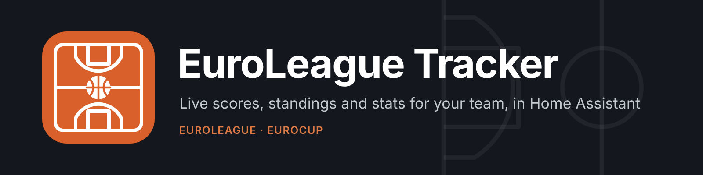
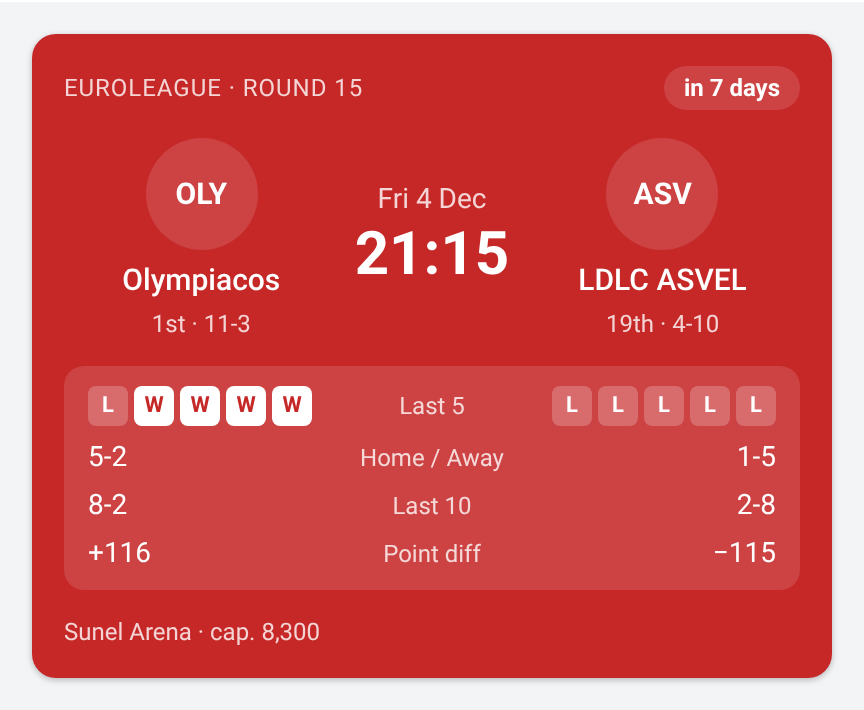
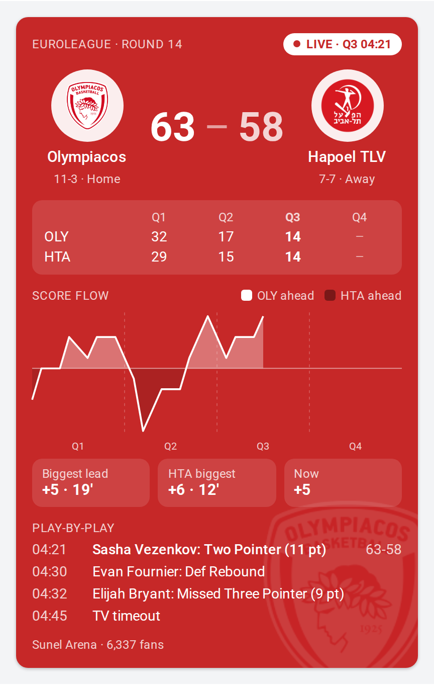
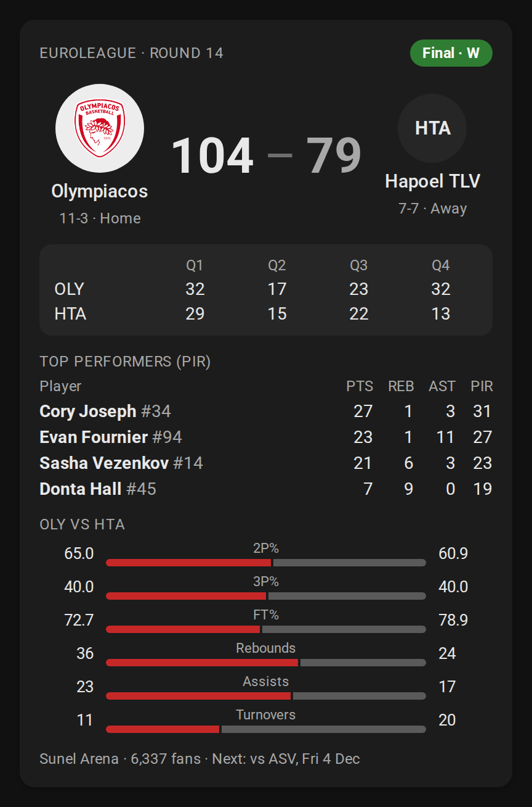
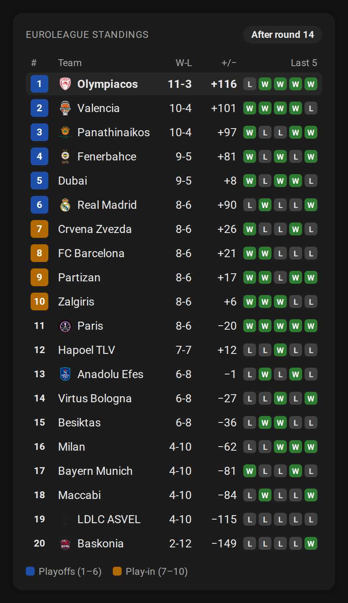
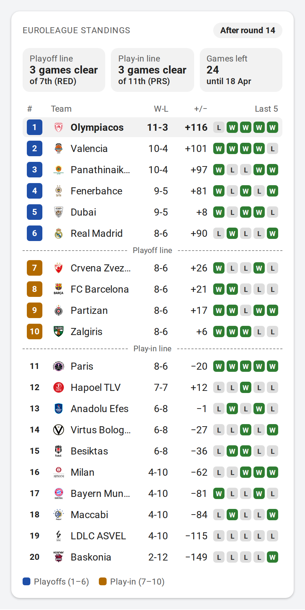
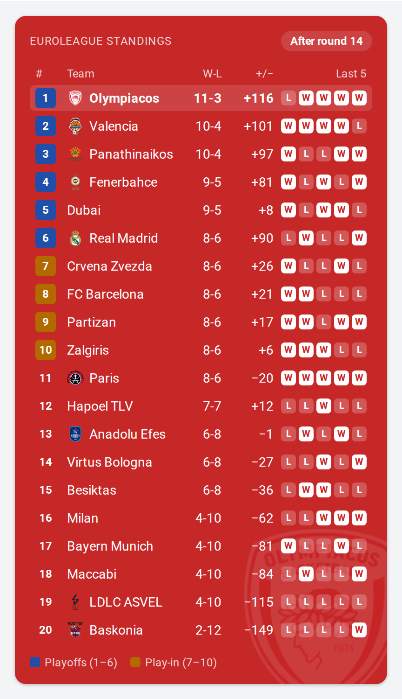
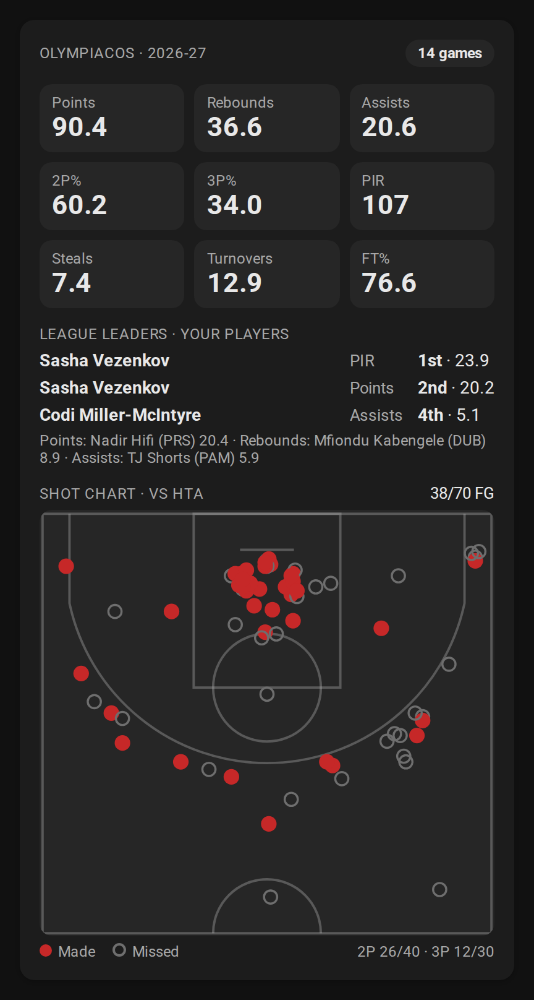
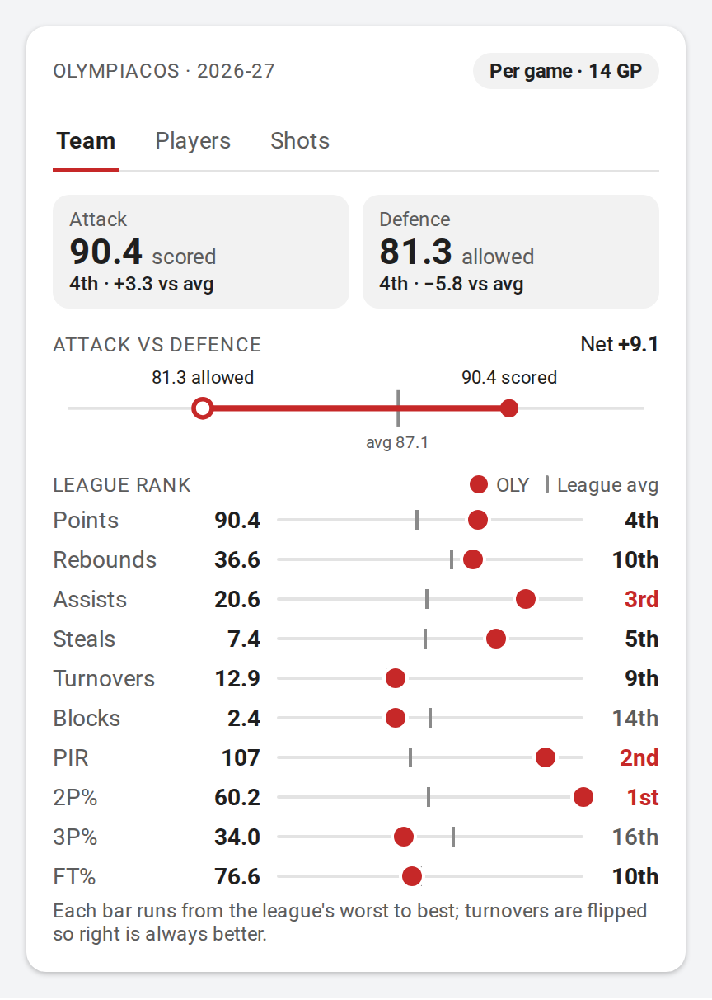
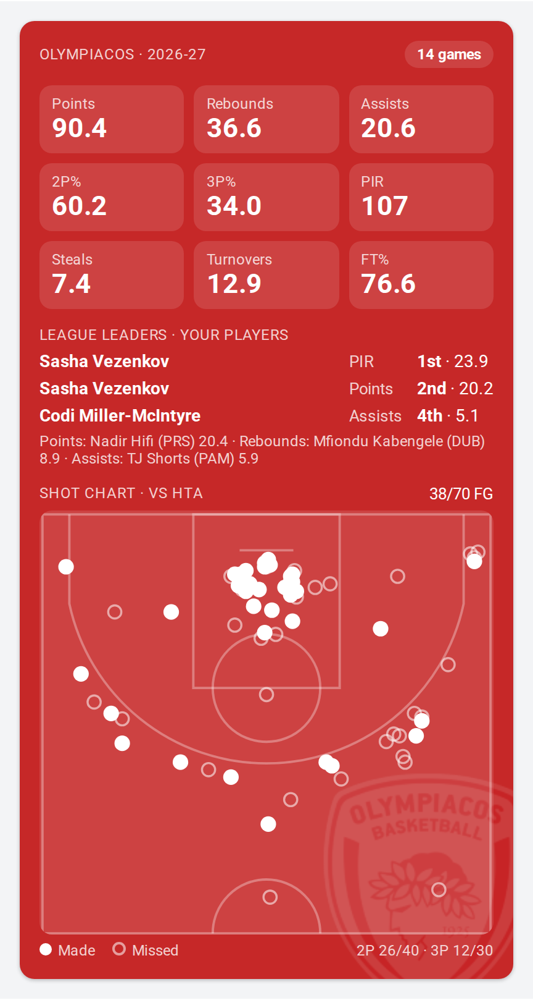

<p align="center">
  
</p>

<p align="center">

[](https://hacs.xyz/docs/faq/custom_repositories/)
[](https://github.com/Big-Edge2297/ha-euroleague-tracker/releases/latest)
[](https://github.com/Big-Edge2297/ha-euroleague-tracker/releases)
[](https://github.com/Big-Edge2297/ha-euroleague-tracker/releases/latest)
[](https://github.com/Big-Edge2297/ha-euroleague-tracker/actions/workflows/validate.yml)

</p>

Follow your **EuroLeague** or **EuroCup** basketball team in Home Assistant: live score and play-by-play, the next game with a countdown, the full standings table, season stats and a shot chart. A dashboard card ships with the integration, with no separate install.

> [!NOTE]
> This is an unofficial project, not affiliated with or endorsed by Euroleague Basketball. It reads the same public data feeds as the EuroLeague website.

## Features

- **Game sensor**, compatible with [ha-teamtracker](https://github.com/vasqued2/ha-teamtracker): state `PRE`, `IN`, `POST` or `NOT_FOUND`, plus the attributes teamtracker uses. [ha-teamtracker-card](https://github.com/vasqued2/ha-teamtracker-card) works with it unchanged.
- **Live games**: score, quarter and clock, quarter-by-quarter scores, play-by-play, team fouls, top players by PIR.
- **Next game**: tip-off in your time zone, countdown, both teams' league position, last 5, home/away record, last 10 and point difference.
- **Standings**: the full table, with your team's position as the sensor state and playoff/play-in zones.
- **Season stats**: per-game averages, where your players rank among the league leaders, and a shot chart from the latest game.
- **An event for every basket**: *Team scored* and *Opponent scored* fire once per free throw, two- or three-pointer, with the player and the score, ready to flash your lights. A delay option lines them up with a TV stream that runs behind.
- **Game events** for tip-off, quarter ends, lead changes and the final buzzer.
- **Entities for everything you'd automate on**: next game (a timestamp), game status, live on/off, both scores, the opponent, plus last result, record, streak, point difference and games behind the playoffs.
- **Bundled card** with four themes (follow Home Assistant, dark, light, team colours) and a visual editor.
- **Adaptive polling**: every 15 minutes between games, every minute before tip-off, every 15 seconds during a game (adjustable).
- Follow several teams, in EuroLeague and EuroCup, by adding the integration once per team.

## Installation

### HACS (recommended)

The integration is waiting to join the HACS default list. Until then, add it as a custom repository:

[](https://my.home-assistant.io/redirect/hacs_repository/?owner=Big-Edge2297&repository=ha-euroleague-tracker&category=integration)

Or by hand:

1. In Home Assistant open **HACS**, then the **⋮** menu → **Custom repositories**.
2. Add `https://github.com/Big-Edge2297/ha-euroleague-tracker` with type **Integration**.
3. Search for **EuroLeague Tracker**, open it and click **Download**.
4. Restart Home Assistant.

### Manual

1. Download `euroleague_tracker.zip` from the [latest release](https://github.com/Big-Edge2297/ha-euroleague-tracker/releases/latest).
2. Unzip it into `config/custom_components/euroleague_tracker/`.
3. Restart Home Assistant.

## Setup

[](https://my.home-assistant.io/redirect/config_flow_start/?domain=euroleague_tracker)

1. **Settings → Devices & services → Add integration → EuroLeague Tracker**.
2. Choose **EuroLeague** or **EuroCup**.
3. Pick your team.

The card registers itself, so you can add it straight away: edit a dashboard → **Add card** → **EuroLeague Tracker**.

### Options

Open the integration and click **Configure**:

| Option | Default | What it does |
|---|---|---|
| Update interval during live games | 15 s | How often the score refreshes while a game is on (5–120 s). |
| Keep showing the final result for | 24 h | How long the game sensor stays on `POST` before switching to the next game. |
| Delay live events by | 0 s | Holds baskets, lead changes and other live events back, so lights and notifications match a TV or stream that runs behind the live data. Usually 20–60 s. |
| Fetch league leaders | on | League leader rankings (a larger download, refreshed twice a day). |

## Entities

Each team adds a device. For Olympiacos in the EuroLeague (entity ids start with `olympiacos_piraeus_euroleague_`):

| Entity | Example state | Notes |
|---|---|---|
| `event.…_team_scored` | `three_pointer` | Fires once per basket: `free_throw`, `two_pointer` or `three_pointer`, with `player`, `points`, `team_score`, `opponent_score`, `quarter`, `clock` |
| `event.…_opponent_scored` | `two_pointer` | The same for the other team |
| `event.…_game_events` | `lead_change` | `game_started`, `quarter_end`, `lead_change`, `game_final` (with `won`) |
| `sensor.…_game` | `PRE` / `IN` / `POST` / `NOT_FOUND` | teamtracker-compatible; every game detail as attributes |
| `sensor.…_game_status` | Upcoming / Live / Final / No game | The same state, readable and translated |
| `binary_sensor.…_live` | on | On while the game is being played |
| `sensor.…_next_game` | 4 Dec, 21:15 | A timestamp: use it in time triggers |
| `sensor.…_team_score`, `sensor.…_opponent_score` | 63, 58 | During and after a game |
| `sensor.…_opponent` | LDLC ASVEL | With the opponent's crest as its picture |
| `sensor.…_standings_position` | 1 | The full table as an attribute |
| `sensor.…_season_stats` | 90.4 pts/game | Per-game averages and league leader ranks |
| `sensor.…_last_result` * | W 104-79 vs HTA | |
| `sensor.…_record` * | 11-3 | |
| `sensor.…_streak` * | W4 | |
| `sensor.…_point_difference` * | +116 | |
| `sensor.…_games_behind_playoffs` * | 0 | Games behind 6th; `games_behind_play_in` (10th) as an attribute |

\* Disabled at first, to keep your entity list short: enable them from the integration's entity list.

<details>
<summary>All game sensor attributes</summary>

**teamtracker-compatible:** `sport`, `league`, `event_name`, `date`, `kickoff_in`, `venue`, `location`, `team_abbr`, `team_id`, `team_name`, `team_record`, `team_homeaway`, `team_logo`, `team_colors`, `team_score`, `team_winner`, `team_timeouts`, the same `opponent_*` set, `quarter`, `clock`, `last_play`, `last_update`, `api_message`.

**EuroLeague extras:** `competition`, `season`, `round`, `round_name`, `phase`, `game_code`, `team_position`, `opponent_position`, `team_form`, `opponent_form` (last 5, oldest first), `team_fouls`, `opponent_fouls`, `attendance`, `capacity`, `quarter_scores`, `top_players`, `game_stats`, `play_by_play`, `shots`, `coach`, `previous_game`, `next_game`, `team_color`.

The bulky attributes (`play_by_play`, `top_players`, `game_stats`, `quarter_scores`, `shots`, the standings `table` and the league leader lists) are left out of the recorder so they don't fill your database.

</details>

## The card

Add it from the card picker, or in YAML:

```yaml
type: custom:euroleague-tracker-card
entity: sensor.olympiacos_piraeus_euroleague_game
```

| Option | Default | Description |
|---|---|---|
| `entity` | required | The game sensor. |
| `view` | `tabs` | `tabs` (Game, Standings, Stats), or just one of `game`, `standings`, `stats`. |
| `theme` | `auto` | `auto` follows your Home Assistant theme; also `dark`, `light`, `team`. |
| `team_color` | club colour | Any hex colour, used for accents and for the `team` theme background. |
| `play_by_play_rows` | `4` | Plays shown during a live game (0 hides them). |
| `standings_rows` | all | Show fewer rows, centred on your team. |
| `show_shot_chart` | `true` | Shot chart on the Stats view. |
| `standings_entity`, `stats_entity` | found automatically | Only needed if you renamed the sensors. |

### Themes

| | Dark | Light | Team colours |
|---|---|---|---|
| Next game |  |  |  |
| Live |  |  |  |
| Final |  |  |  |
| Standings |  |  |  |
| Stats |  |  |  |

These screenshots are generated automatically from real EuroLeague data every time the card changes (see [Development](#development)).

## Automations

The event entities are the easiest trigger: pick *Olympiacos scored* in the automation editor and, if you like, a shot type. Each basket fires on its own, even when several land between two updates. With **Delay live events by** set, they fire that many seconds later, in step with your TV.

<details>
<summary>Flash the lights when your team scores (threes only)</summary>

```yaml
alias: Olympiacos three-pointer
triggers:
  - trigger: state
    entity_id: event.olympiacos_piraeus_euroleague_team_scored
    not_from: unavailable
conditions:
  - condition: state
    entity_id: event.olympiacos_piraeus_euroleague_team_scored
    attribute: event_type
    state: three_pointer
actions:
  - action: light.turn_on
    target:
      entity_id: light.living_room
    data:
      color_name: red
      flash: short
```

Remove the condition to flash on every basket.

</details>

<details>
<summary>Notify the final result</summary>

```yaml
alias: EuroLeague final score
triggers:
  - trigger: state
    entity_id: event.olympiacos_piraeus_euroleague_game_events
    attribute: event_type
    to: game_final
actions:
  - action: notify.mobile_app_my_phone
    data:
      title: "{{ 'Win!' if trigger.to_state.attributes.won else 'Loss' }}"
      message: >
        {{ trigger.to_state.attributes.team }} {{ trigger.to_state.attributes.team_score }} –
        {{ trigger.to_state.attributes.opponent_score }} {{ trigger.to_state.attributes.opponent }}
```

</details>

<details>
<summary>Reminder 30 minutes before tip-off</summary>

```yaml
alias: Game starting soon
triggers:
  - trigger: time
    at:
      entity_id: sensor.olympiacos_piraeus_euroleague_next_game
      offset: "-00:30:00"
actions:
  - action: notify.mobile_app_my_phone
    data:
      message: >
        Tip-off in 30 minutes against
        {{ state_attr('sensor.olympiacos_piraeus_euroleague_next_game', 'opponent') }}
```

</details>

Every moment is also sent as an `euroleague_tracker_event` on the event bus, with a `type` of `game_started`, `quarter_end`, `team_scored`, `opponent_scored`, `lead_change` or `game_final`, and the same data as the entities (`points`, `shot` and `player` on baskets).

## FAQ

**Is the data official?**
It comes from EuroLeague's public API, the same one its website uses. There's no published developer programme, so EuroLeague could change or lock it at any time. If it starts refusing requests, a notice appears under **Settings → Repairs** and the integration keeps retrying; check the [issues](https://github.com/Big-Edge2297/ha-euroleague-tracker/issues) for news.

**Why do standings points differ from points scored?**
EuroLeague leaves overtime points out of the standings (points for, against and difference). The standings sensor shows the official standings values; the stats sensor shows real points scored.

**The logos don't show.**
They load from EuroLeague's image servers in your browser. If a network blocks them, the card shows the team code instead.

**Why don't I see the integration's icon?**
Home Assistant shows icons that ship with a custom integration from version 2026.3. On older versions you'll see a placeholder; everything else works.

**Can I use it with ha-teamtracker-card?**
Yes. Point the teamtracker card at the game sensor.

## Development

```bash
npm ci
npm run build        # build the card into custom_components/…/frontend/
npm test             # card tests (Node's test runner + jsdom)
pip install -r requirements_test.txt
pip install "$(python scripts/frontend_requirement.py)"
pytest               # integration tests, against real recorded API data
python scripts/make_demo_states.py && python scripts/screenshots.py   # regenerate docs/images
```

Every push runs the integration tests on the oldest supported Home Assistant (2025.1) and the newest, the card tests, HACS and hassfest validation, and a dependency audit. Dependabot proposes updates every Monday. See [CONTRIBUTING.md](CONTRIBUTING.md) for how releases work.

## Changelog

See [CHANGELOG.md](CHANGELOG.md) or the [releases page](https://github.com/Big-Edge2297/ha-euroleague-tracker/releases).

## License

[MIT](LICENSE). EuroLeague, EuroCup and club names and logos belong to their owners.
